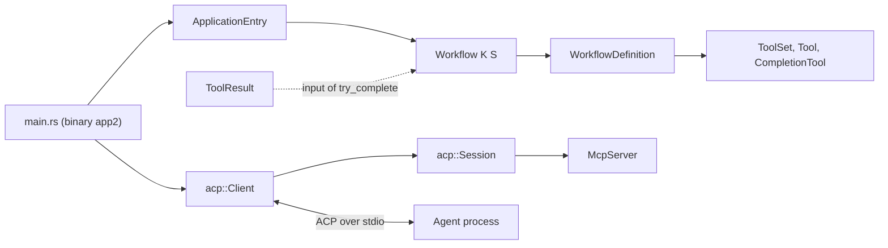
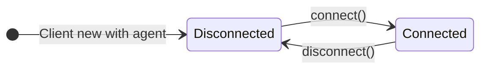
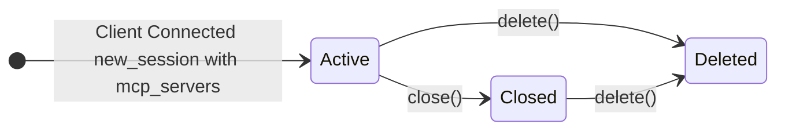
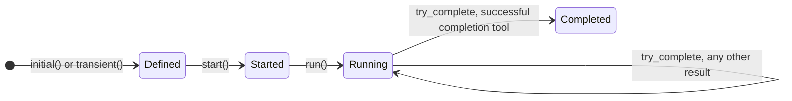
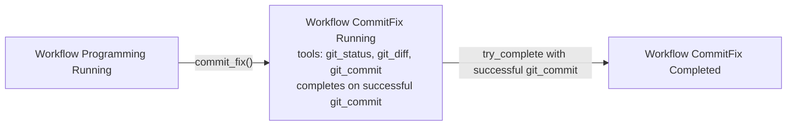
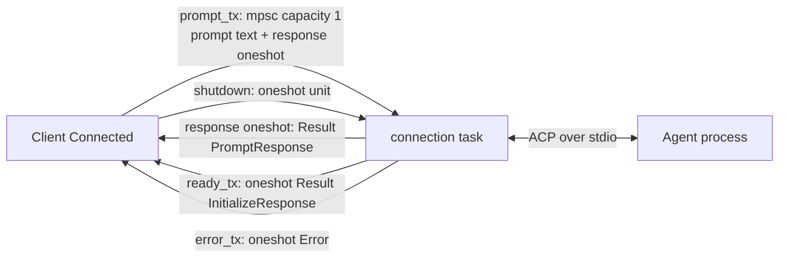
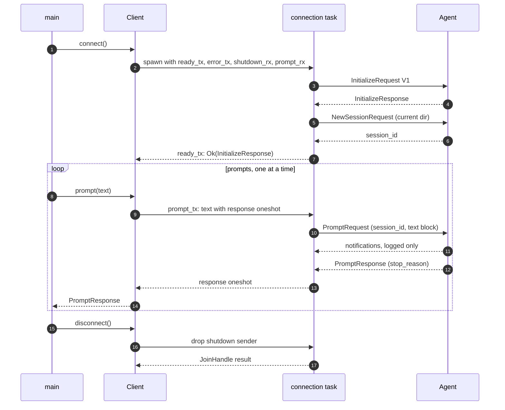
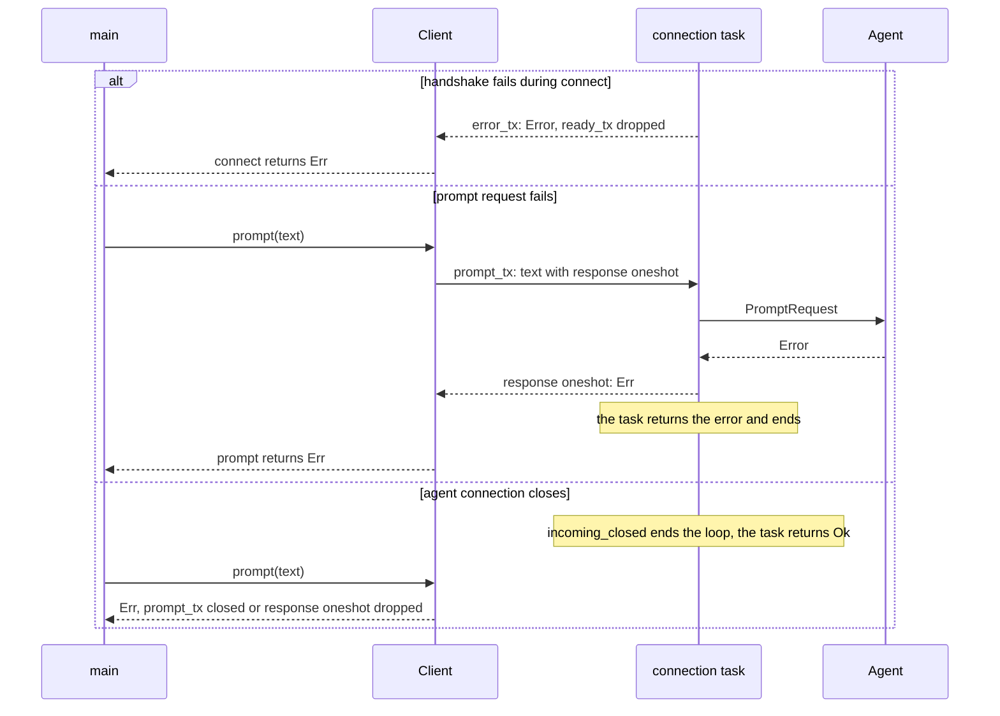
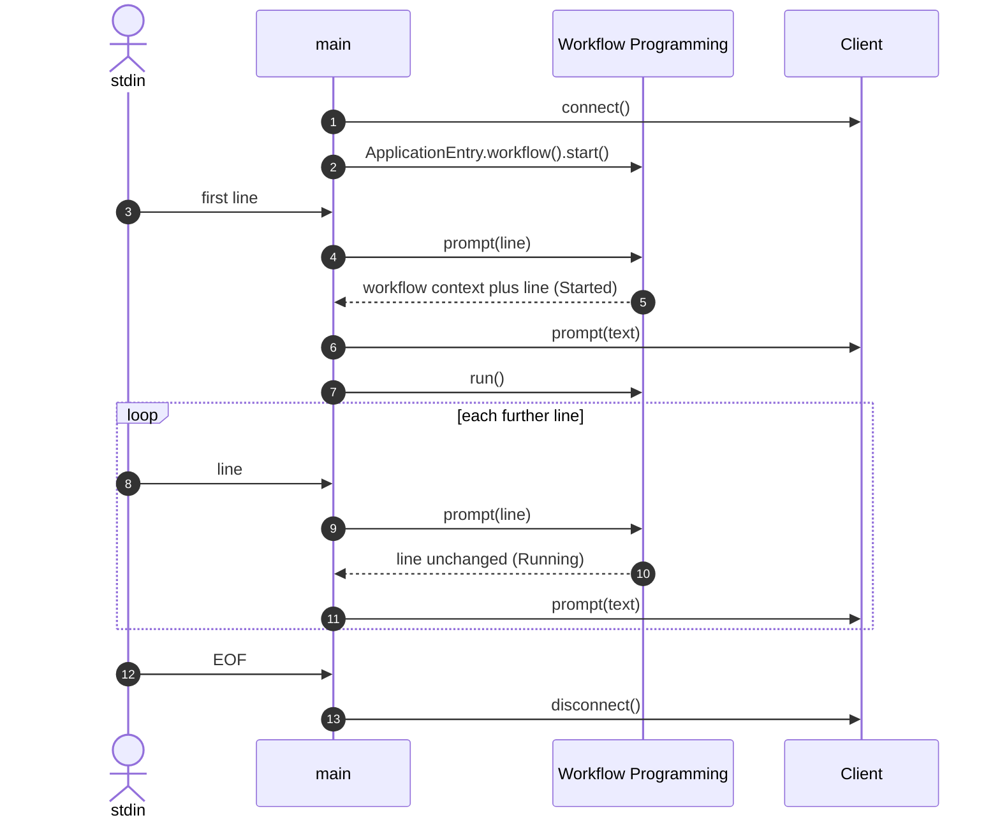

# Architecture

`app2` is a typestate model of an ACP client, sessions, and workflows, with its own binary. `main.rs` is the only place where the client and the workflow meet.

## Overview

`Planning` has an initial definition but no prompt provider yet. `Session` is not tied to an ACP session, and nothing produces `ToolResult` values yet.

## Typestates

## Channels

`Client::connect` spawns one connection task that owns the ACP connection. The caller side talks to it only through these channels.

| Channel | Kind | From → To | Payload | Notes |
|---|---|---|---|---|
| `ready_tx` | oneshot | task → `connect()` | `Result<InitializeResponse, Error>` | Sent after `initialize` and `session/new`. |
| `error_tx` | oneshot | task → `connect()` | `Error` | Read only when `ready_tx` was dropped, so the handshake error reaches the caller. |
| `shutdown` | oneshot | `Client<Connected>` → task | `()` | `disconnect()` drops the sender. |
| `prompt_tx` | mpsc, capacity 1 | `Client::prompt` → task | prompt text plus a response oneshot | The task handles one prompt at a time. |
| response oneshot | oneshot | task → `Client::prompt` | `Result<PromptResponse, Error>` | One per prompt. |

The task loop ends on `shutdown`, on `incoming_closed()` of the connection, or when `prompt_tx` is closed. Agent notifications are only logged.

## Sequences

### Connect and prompt

### Failure paths

### Application loop

