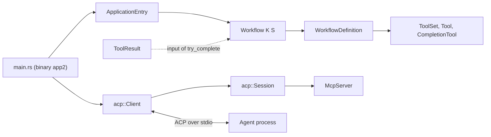
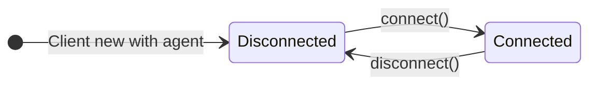
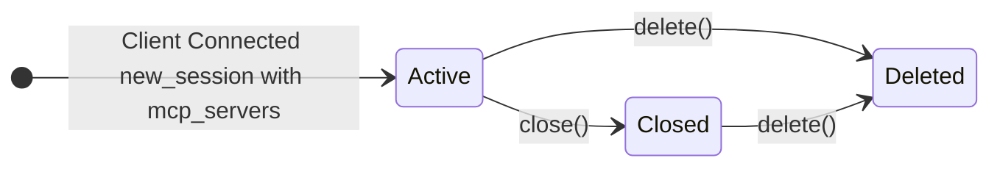
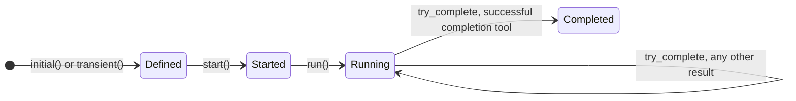
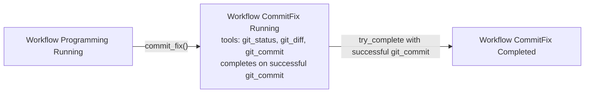
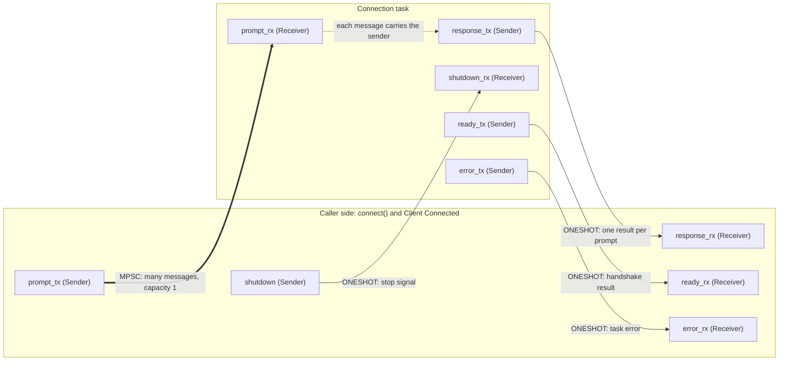
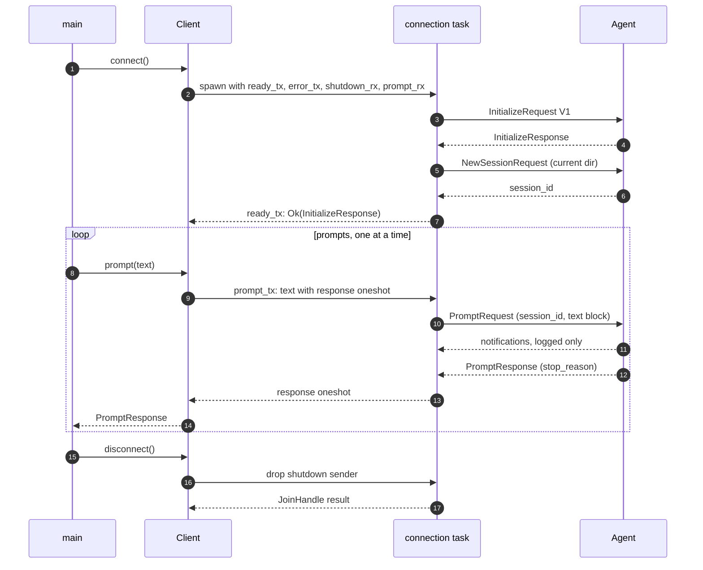
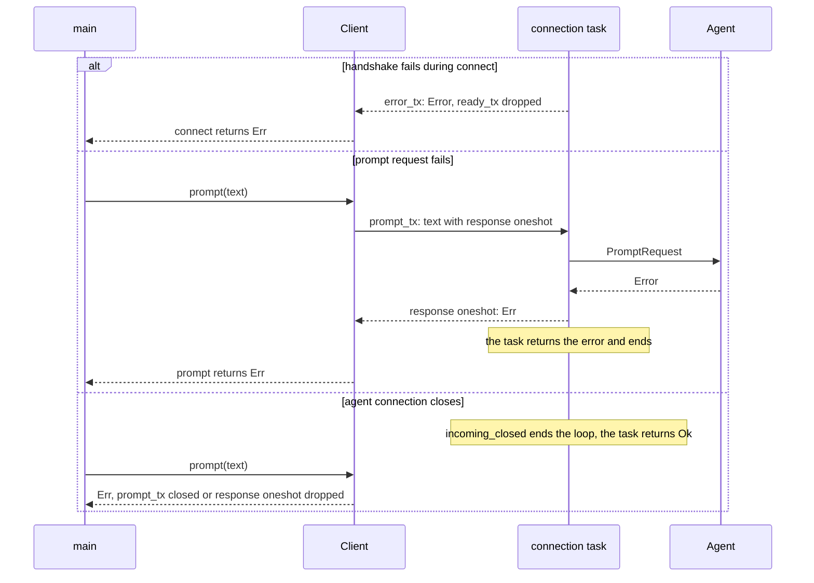
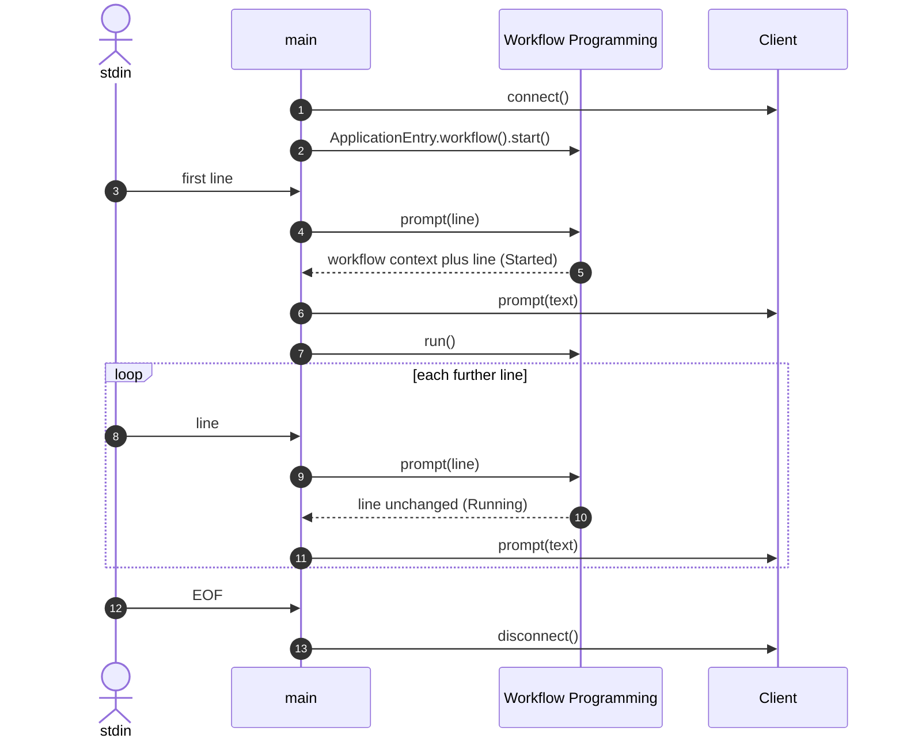

# Architecture

`app2` is a typestate model of an ACP client, sessions, and workflows, with its own binary. `main.rs` is the only place where the client and the workflow meet.

## Overview

`Planning` has an initial definition but no prompt provider yet. `Session` is not tied to an ACP session, and nothing produces `ToolResult` values yet.

## Typestates

## Channels

`Client::connect` spawns one connection task that owns the ACP connection. Caller and task share five channels. Each channel has a sender end on one side and a receiver end on the other.

Thick arrow: `mpsc`, many messages over time. Thin arrow: `oneshot`, exactly one message, then closed. Dotted arrow: not a channel. It shows that `response_tx` arrives inside the prompt message, so every prompt gets its own `oneshot`.

| Kind | Messages | Ends | Used for |
|---|---|---|---|
| `mpsc` | many, buffered | many senders, one receiver. Only one sender exists here, so it behaves like SPSC. | `prompt_tx` |
| `oneshot` | exactly one | one sender, one receiver. A sender dropped without sending makes the receiver return an error. | the other four |

`broadcast`, `watch`, and MPMC channels are not used.

| Channel | Carries | Notes |
|---|---|---|
| `prompt_tx` | prompt text plus a fresh `response_tx` | Capacity 1, so `prompt()` waits while the task is busy. One prompt at a time. |
| response | `Result<PromptResponse, Error>` | New per prompt. |
| `shutdown` | `()` | `disconnect()` drops the sender. |
| ready | `Result<InitializeResponse, Error>` | Sent after `initialize` and `session/new`. `connect()` waits on it. |
| error | `Error` | Read only when `ready_tx` was dropped, so the handshake error reaches the caller. |

The task loop ends on `shutdown`, on `incoming_closed()` of the connection, or when `prompt_tx` is closed. Agent notifications are only logged.

## Sequences

### Connect and prompt

### Failure paths

### Application loop

